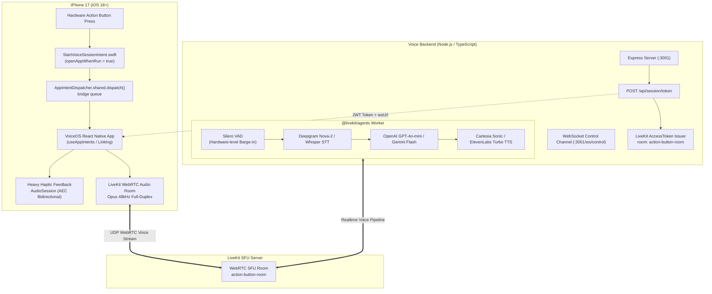

# VoiceOS: iPhone 17 Action Button Real-Time AI Voice Assistant

A production-grade, low-latency, full-duplex real-time voice assistant triggered by the native **iPhone 17 Action Button**, built on **Expo (React Native TypeScript)**, **Apple App Intents**, **LiveKit WebRTC**, and **@livekit/agents**.

Designed for the **Windows Developer**: compile the native iOS shell **once** in the cloud using GitHub Actions (`macos-latest`), sideload via Sideloadly over USB-C, and enjoy continuous hot-reloading from Windows thereafter.

---

## 🏗 System Architecture



---

## 📁 Repository Structure

```
woray/
├── .github/
│   └── workflows/
│       └── build-ios-shell.yml    # GitHub Actions macOS builder -> unsigned .ipa for Sideloadly
├── apps/
│   ├── ios-client/                # Expo React Native client
│   │   ├── app-intents/           # Native Swift AppIntents watched by expo-app-intents
│   │   │   ├── StartVoiceSessionIntent.swift  # Action Button trigger intent
│   │   │   └── AppShortcuts.swift             # iOS Settings & Shortcuts registration
│   │   ├── App.tsx                # Client UI, LiveKit Room & intent listeners
│   │   ├── index.ts               # registerGlobals() AEC & WebRTC C++ initializer
│   │   ├── app.json               # Config plugins & iOS background audio modes
│   │   ├── metro.config.js        # Monorepo resolution config
│   │   └── package.json
│   └── voice-backend/             # Standalone Real-time Voice Server
│       ├── src/
│       │   ├── server.ts          # Express token issuer + WebSocket control channel
│       │   └── agent.ts           # @livekit/agents worker (Silero VAD + STT + LLM + TTS)
│       ├── .env.example
│       ├── tsconfig.json
│       └── package.json
├── package.json                   # Root monorepo workspace configuration
└── README.md
```

---

## 🚀 Step-by-Step Developer Guide (Windows)

### Phase 1: Compile Native iOS Shell Once in the Cloud

You **do not** need a local Mac or Xcode installed on Windows.

1. Push this repository to GitHub.
2. Go to **GitHub Actions** -> **Build iOS Dev-Client Shell (.ipa)**.
3. Click **Run workflow** (`workflow_dispatch`).
4. The workflow:
   - Installs dependencies.
   - Runs `npx expo prebuild --platform ios --clean`.
   - Runs `pod install`.
   - Compiles an unsigned Debug Dev-Client `.app` bundle.
   - Zips it into `VoiceOS-DevClient.ipa` and uploads it as an artifact.
5. Download `VoiceOS-DevClient-ipa` from the GitHub Actions run summary.

---

### Phase 2: Sideload onto iPhone 17 via Sideloadly

1. Connect your iPhone 17 to your Windows PC via USB-C.
2. Launch [Sideloadly](https://sideloadly.io/).
3. Drag and drop `VoiceOS-DevClient.ipa` into Sideloadly.
4. Enter your Apple ID and click **Start**.
5. Once installed, on your iPhone go to:
   - **Settings** -> **General** -> **VPN & Device Management** -> Trust your developer certificate.
   - **Settings** -> **Privacy & Security** -> **Developer Mode** -> Turn **On** (device reboots).

---

### Phase 3: Configure iPhone 17 Action Button

1. On your iPhone, open **Settings** -> **Action Button**.
2. Swipe to the **Shortcut** option.
3. Tap the selection menu: `VoiceOS` will automatically appear in the list under **Activate VoiceOS** (registered natively by `AppShortcuts.swift`).
4. Select **Activate VoiceOS**.
5. Holding the Action Button now wakes the app immediately into the foreground, triggers heavy haptic feedback, and establishes the LiveKit full-duplex audio stream.

---

### Phase 4: Running the Local Backend & Dev Server

#### 1. Setup Environment
In `apps/voice-backend`:
```bash
cp .env.example .env
```
Fill in your credentials:
- `LIVEKIT_URL` (from [LiveKit Cloud](https://cloud.livekit.io) or self-hosted)
- `LIVEKIT_API_KEY`
- `LIVEKIT_API_SECRET`
- `OPENAI_API_KEY` (and/or `DEEPGRAM_API_KEY`, `CARTESIA_API_KEY`, `ELEVENLABS_API_KEY`)

#### 2. Start Voice Backend & Agent Worker
```bash
# Terminal 1: Token server & WebSocket control channel
npm run dev:backend

# Terminal 2: Realtime LiveKit AI Agent Worker
npm run agent:backend
```

#### 3. Start Expo Dev Server from Windows
```bash
npm run start:client
```
Scan the QR code with your iPhone 17 camera or tap your device in the list. The sideloaded native shell connects to Metro and hot-reloads instantly.

---

## ⚡ Technical Highlights

- **Hardware AEC & AudioSession:** `@livekit/react-native`'s `registerGlobals()` executes at the top of `index.ts`, placing iOS `AVAudioSession` into hardware voice-chat mode (`AVAudioSessionCategoryPlayAndRecord` with `voiceChat` mode and hardware echo cancellation).
- **Zero-Latency Intent Wake:** `StartVoiceSessionIntent` specifies `openAppWhenRun = true`, causing iOS to wake the app into the foreground before executing JS code.
- **At-Least-Once Delivery:** Uses `AppIntentDispatcher.shared.dispatch` with persistent native queueing and `removePendingInvocationAsync` in JS to guarantee wake commands are never dropped during cold boots.
- **Full Barge-In Support:** Silero VAD runs server-side on the incoming Opus WebRTC audio stream, instantly cutting off agent TTS generation when the user speaks.
